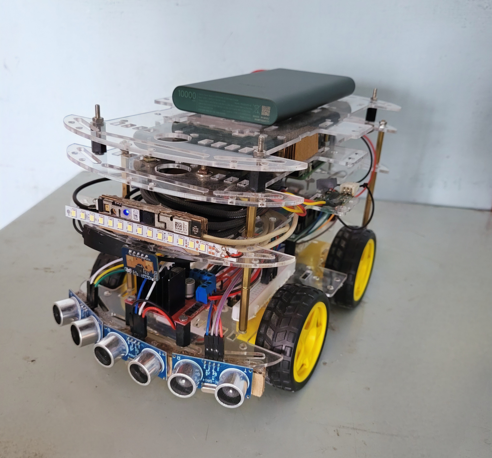
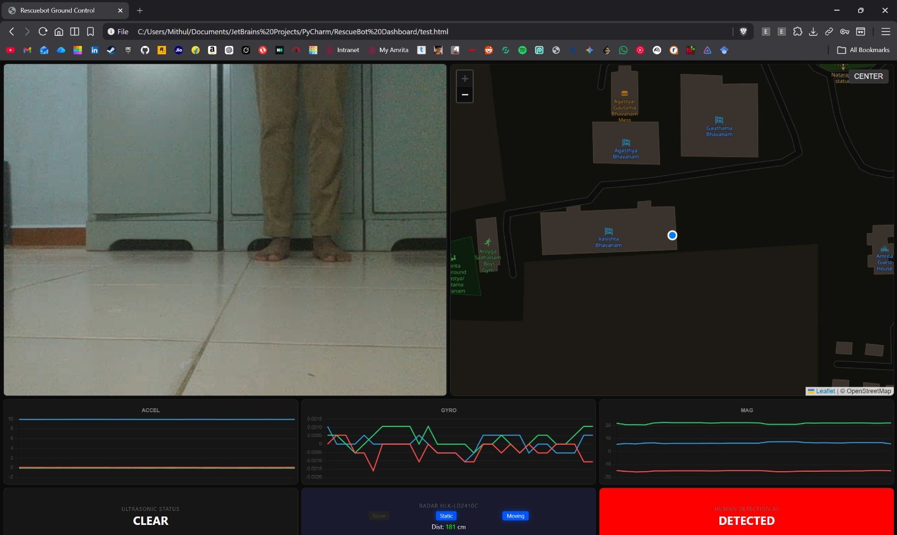
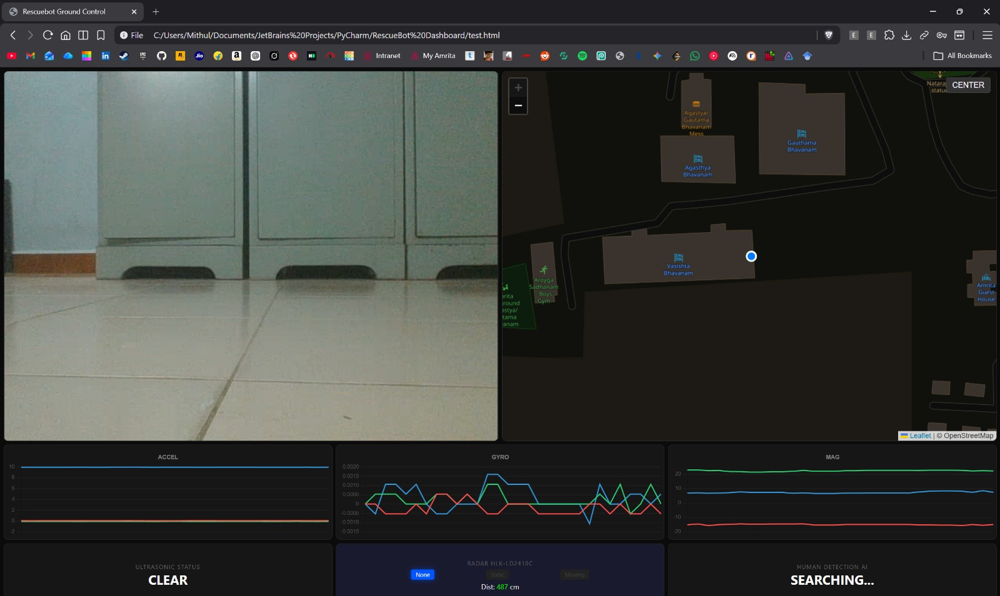
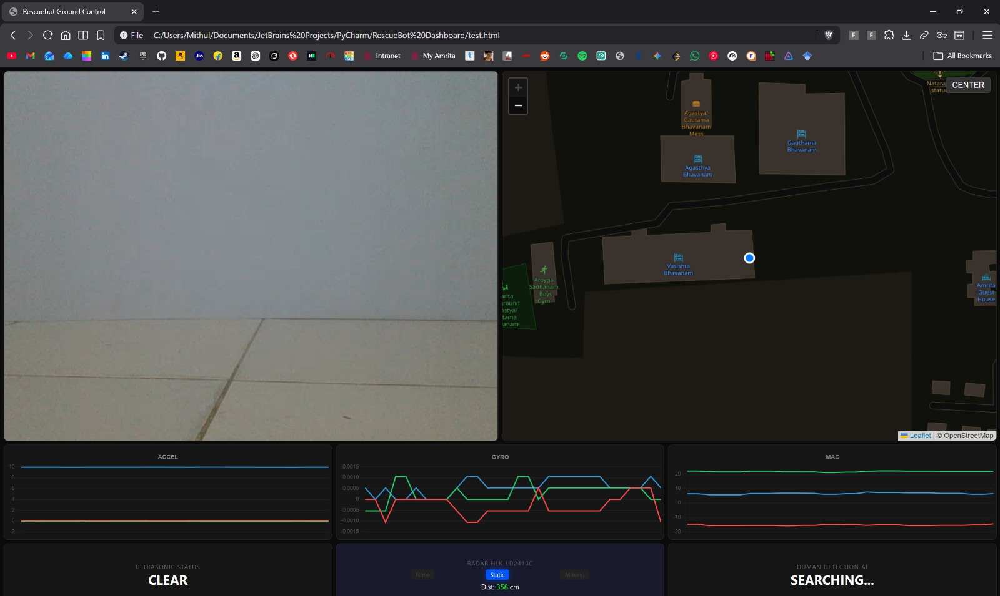

# Dual-Perception Reconnaissance UGV for Post-Disaster Environments

An autonomous and teleoperated Unmanned Ground Vehicle (UGV) designed for search and rescue operations in post-disaster environments. The system features a decentralized multi-processor edge computing architecture combining **Edge AI Vision**, **24GHz FMCW Millimeter-Wave Radar**, **Ultrasonic obstacle detection**, **Long-Range (LoRa) telemetry**, and **low-latency bidirectional voice communication**.

---

## 📷 Hardware Prototype

| Assembled Prototype | Front Sensor View |
| :---: | :---: |
|  |  |

| Chassis & Actuation | Top Electronics View |
| :---: | :---: |
|  |  |

---

## ⚙️ Key System Specifications

- **Compute & Cognitive Core:** Raspberry Pi 5 (Single Board Computer running Linux).
- **Kinematic & Sensor Controller:** ESP32 Microcontroller communicating over UART serial.
- **Isolated Dual-Power Topology:**
  - *Logic & Compute:* Dedicated 10,000 mAh Power Delivery (PD) bank (5V / 3A) preventing brownouts.
  - *Traction & Motors:* Dedicated 2S 18650 Li-ion battery pack (7.4V nominal) driving an L298N dual H-bridge motor controller and BO geared motors.
- **Dual-Perception Human Detection:**
  - *Optical Edge AI:* YOLOv8n object detection (`person` class) combined with YOLOv8n-Pose keypoint estimation for posture verification.
  - *FMCW Radar:* HLK-LD2410C 24GHz Millimeter-Wave radar operating via serial UART at 256,000 baud for through-dust/smoke motion and static micro-movement sensing.
- **Hybrid Long-Range Telemetry:**
  - Adafruit RFM9x LoRa Transceiver module (433 MHz SPI) for reliable, non-line-of-sight packet telemetry to a base station without reliance on cellular infrastructure.
  - Local REST / UDP telemetry server with phone GPS NMEA sentence parser (`pynmea2`).
- **Tactical Two-Way Audio:**
  - Bidirectional PyAudio client-server pipeline over TCP with noise gating (RMS hysteresis) and software gain boost.

---

## 📁 Repository Structure

```
├── hardware_photos/              # High-resolution hardware photographs of the UGV prototype
│   ├── ugv_prototype_assembled.jpg
│   ├── ugv_hardware_front_view.jpeg
│   ├── ugv_hardware_chassis_view.jpeg
│   └── ugv_hardware_top_view.jpeg
│
├── human_object_detection/       # Standalone AI perception scripts
│   ├── brain2_pose.py            # Keypoint & pose-based human detection
│   ├── brain3_fusion.py          # Dual-model perception fusion (YOLO + Pose)
│   ├── human_detection.py        # Real-time webcam person detector
│   ├── yolov8n.pt                # Nano YOLO detection weights
│   └── yolov8n-pose.pt           # Nano YOLO pose estimation weights
│
├── robot-codes/                  # Production robot runtime microservices
│   ├── core_start.sh             # Tmux orchestration launcher for all background services
│   ├── audio/
│   │   └── rb_comms.py           # Noise-gated bidirectional audio transceiver
│   ├── controller/
│   │   └── main.py               # ESP32 serial bridge, Pygame joystick, & autonomous obstacle avoidance FSM
│   ├── lora/
│   │   └── server.py             # 433MHz LoRa packet broadcast service
│   ├── robot_vision/
│   │   └── main.py               # Real-time edge video inference & REST reporter
│   └── server/
│       └── main.py               # Flask telemetry hub, GPS NMEA parser, & HLK radar decoder
│
├── .gitignore                    # Protects unpublished research & excludes large datasets/videos
├── requirements.txt              # Python package dependencies
└── README.md                     # Documentation
```

---

## 🚀 Microservice Architecture & Startup

The robot runs a suite of modular Python microservices orchestrated via `robot-codes/core_start.sh` inside a tiled `tmux` session:

| Service | Script | Port / Interface | Function |
| :--- | :--- | :--- | :--- |
| **Media Server** | MediaMTX | RTSP / WebRTC | Ultra-low latency camera video streaming |
| **Controller** | `controller/main.py` | `/dev/ttyUSB0` & UDP `5005` | Manual driving & Autonomous obstacle avoidance state machine |
| **Vision AI** | `robot_vision/main.py` | `/dev/video3` | Real-time dual YOLO inference reporting to Flask server |
| **Telemetry Server** | `server/main.py` | HTTP `5001` & UART `/dev/ttyAMA0` | Aggregates GPS, HLK radar, ultrasonic, and AI status |
| **LoRa Broadcast** | `lora/server.py` | SPI (GPIO 17, 27) @ 433 MHz | Periodic long-range telemetry broadcast |
| **Audio Link** | `audio/rb_comms.py` | TCP `5000` (RX) / `5001` (TX) | Full-duplex tactical communication link |

### Starting All Services on the Robot

```bash
cd robot-codes
chmod +x core_start.sh
./core_start.sh
```

---

## 🛠️ Installation & Setup

### 1. Prerequisites
- Python 3.9+
- Linux (Raspberry Pi OS) recommended for hardware interfacing (SPI, UART, `/dev/video*`, `/dev/ttyUSB*`)

### 2. Install Python Dependencies
```bash
pip install -r requirements.txt
```

---

## 🎮 Autonomous Obstacle Avoidance State Machine

When activated (toggleable via gamepad Start button), `controller/main.py` transitions between states based on real-time ultrasonic feedback:
- **`DRIVING`**: Advances forward while path clearance is confirmed (`K`).
- **`TURNING_RIGHT`**: Initiates a 90° tank turn upon obstacle detection.
- **`TURNING_LEFT`**: If right path is blocked, performs a 180° sweep to evaluate the left corridor.
- **`TURNING_BACK`**: If both lateral pathways are obstructed, completes rotation to escape dead ends.
